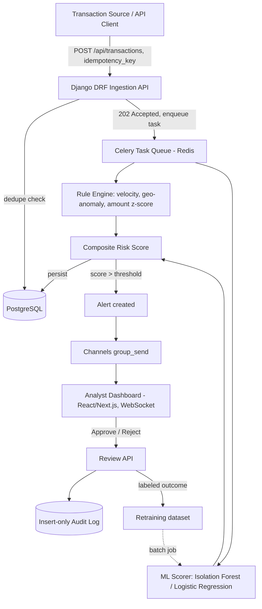
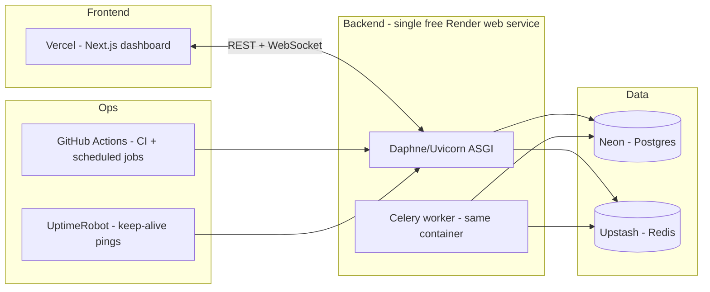

# FraudGuard — Real-Time Fraud Detection Engine
### Full project plan: system design, features, testing, and free production deployment

**What this is:** a Django + DRF backend that ingests financial transactions, scores them for fraud risk using a rule engine + ML model in an async pipeline, and pushes flagged transactions to an analyst dashboard in real time over WebSockets, with an insert-only audit trail for every decision.

**Why this project:** it forces you through the exact problems real fintech backend systems solve — idempotent ingestion, async decoupling, real-time push, explainable scoring, and auditability — rather than another CRUD app with a login page.

---

## 1. System Architecture

The core decision this makes: **ingestion never blocks on scoring.** A transaction is durably written and acknowledged first; scoring happens asynchronously and pushes results forward, not backward.

---

## 2. Tech Stack

| Layer | Technology | Why |
|---|---|---|
| Backend framework | Django + Django REST Framework | Fast to build a real API surface with auth, throttling, serialization built in |
| Async task queue | Celery | Decouples ingestion from scoring |
| Broker / cache | Redis | Celery broker, Channels layer, velocity-check counters |
| Real-time push | Django Channels + channels-redis | WebSocket broadcast to analyst dashboard |
| Database | PostgreSQL | JSONField for contributing-factors data, strong indexing, transactional migrations |
| Auth | djangorestframework-simplejwt | Token auth with role claims |
| ML | scikit-learn (Isolation Forest / Logistic Regression) + joblib | Simple, explainable, easy to retrain offline |
| Frontend dashboard | React / Next.js | Matches your existing stack; consumes REST + WebSocket |
| Testing | pytest-django, factory-boy, Locust | Unit, integration, load |

---

## 3. Data Models

- **Account** — user FK, rolling stats (avg spend, stddev, last known location, last transaction time), updated incrementally.
- **Transaction** — account FK, amount, currency, merchant, geo, timestamp, `idempotency_key` (unique constraint), status.
- **RiskScore** — transaction FK, composite score, model version, JSONField of contributing factors (explainability, not just a number).
- **Alert** — transaction FK, risk score FK, status (pending/approved/rejected), assigned analyst, timestamps.
- **AuditLog** — actor, action, target, payload, timestamp. **Insert-only**: revoke `UPDATE`/`DELETE` on this table at the database role level, not just in application code.
- **APIClient** — for ingestion auth; throttle per-client, not per-user, since this is a B2B ingestion surface.

---

## 4. Core Features (build these — this is the MVP)

1. Idempotent transaction ingestion API (dedupe on `idempotency_key`)
2. Rule engine: velocity checks (Redis sorted sets), impossible-travel, amount z-score
3. Async scoring pipeline (Celery)
4. ML anomaly scoring (trained offline, loaded once per worker)
5. Composite risk score with explainable contributing factors
6. Real-time alert push to analyst dashboard (Channels + WebSocket)
7. Analyst review workflow (approve/reject)
8. Insert-only audit log
9. RBAC: `ingestion_client` / `analyst` / `admin`
10. Per-client rate limiting on ingestion

## 5. Stretch Features (add after the MVP works end-to-end)

- Batch retraining job that consumes analyst-labeled outcomes (Celery beat or scheduled GitHub Action)
- Backtesting dashboard: precision/recall/F1 charts against a labeled dataset
- Synthetic live-transaction generator for demos (also doubles as your load-test traffic source)
- Multi-tenant support if you want to push it toward a sellable SaaS angle later

---

## 6. Testing Strategy

| Type | Tool | What it proves |
|---|---|---|
| Unit | pytest-django | Rule engine functions behave correctly in isolation |
| Integration | pytest + `CELERY_TASK_ALWAYS_EAGER=True` | Ingestion → task → score flow works without needing a live broker |
| Real-time | Channels `WebsocketCommunicator` | Alerts actually broadcast, not just get created silently |
| Load | Locust (free, open source) | Ingestion holds up under concurrent traffic — gives you real throughput numbers |
| Backtesting | Custom script | Precision/recall/F1 against a labeled dataset — the actual validation method real fraud systems use |

---

## 7. Free Real-World Data Sources

- **Kaggle Credit Card Fraud Detection (ULB)** — real anonymized cardholder transactions, ~285K rows, labeled. Best for training/backtesting the ML scorer.
- **PaySim (Synthetic Financial Datasets for Fraud Detection, Kaggle)** — simulated mobile-money transactions with time-steps, balances, and fraud labels. Best fit for testing velocity-style logic since it has real time-series structure.
- **IEEE-CIS Fraud Detection (Kaggle)** — richer real-world feature set (device/email metadata) if you want to go deeper on the ML side later.
- **Your own synthetic generator (Faker)** — no public dataset includes geo data for privacy reasons, so write a small script simulating accounts with a home location and occasional "impossible" jumps. This also becomes your live demo traffic source.

All free via the Kaggle API (`pip install kaggle`, free token) — script the download rather than hand-fetching CSVs.

---

## 8. Free Production Deployment

| Component | Free provider | Catch to know about |
|---|---|---|
| Postgres | Neon or Supabase | Both have permanent free tiers; Render's free Postgres expires after a fixed window, so prefer Neon/Supabase for anything you want to keep |
| Redis (broker + channel layer) | Upstash | Free tier covers 500K commands/month and 256MB — plenty for a demo-scale system |
| Backend (Django + Channels) | Render free web service | Sleeps after inactivity; first request after idle has a cold-start delay |
| Celery worker | **Same Render web service as the backend** | Render's free plan does not offer a separate background-worker service type — only web, Postgres, Redis, and static sites are free. Run the worker as a second process inside the one free web service (a startup script launching both Daphne and `celery worker`) rather than architecting for a separate free worker service that doesn't exist |
| Scheduled/batch jobs | GitHub Actions (free minutes on public repos) | Use a scheduled workflow hitting an admin endpoint instead of Render Cron Jobs, which also aren't on the free plan |
| Frontend | Vercel free tier | No sleep, great Next.js support, deploy separately from the backend |
| Uptime | UptimeRobot free tier | Optional periodic pings to reduce how often the backend cold-starts |

**Be upfront about this in interviews:** the single-container worker pattern is a free-tier constraint, not how you'd run this in real production (there you'd want the worker horizontally scaled and separate from the web process for isolation and independent scaling). Knowing *why* it's different and being able to describe the production version is worth more than pretending the free deployment is production-grade.

---

## 9. Build Roadmap

| Phase | Focus |
|---|---|
| 1 | Django + DRF project, Postgres, Account/Transaction models, JWT auth, idempotent ingestion endpoint |
| 2 | Rule engine as synchronous functions first — prove the logic before adding async |
| 3 | Celery + Redis, move rule engine into a task, add retry policy |
| 4 | Train ML model offline (Kaggle/PaySim data), serialize with joblib, load once per worker, combine into composite score |
| 5 | Channels + Redis channel layer, analyst WebSocket consumer, alert broadcasting |
| 6 | Review endpoints, insert-only audit log, labeled-outcome storage |
| 7 | Throttling, RBAC, DB-level lockdown of the audit table, indexing |
| 8 | React/Next.js dashboard, synthetic transaction generator, backtesting script with precision/recall output |
| 9 | Deploy: Neon + Upstash + Render (combined worker) + Vercel, write up the tradeoffs |

Roughly a week per phase is realistic alongside coursework/internship — 8-9 weeks end to end.

---

## 10. Security & Compliance Notes

- `REVOKE UPDATE, DELETE` on the audit log table at the database role level — defense beyond application code
- JWT short expiry + refresh rotation
- Secrets via environment variables (Render env groups / Vercel env vars), never committed
- Per-client throttling on ingestion to prevent one bad actor from starving the queue
- Composite score stores *why* it flagged a transaction (contributing factors), not just a number — explainability matters both for real systems and for you being able to defend the design

---

## 11. Resume / Interview Talking Points

- Idempotent API design and why retried requests are a real production concern
- Async pipeline design: why scoring is decoupled from ingestion
- Real-time push (WebSockets) vs. polling, and the tradeoffs
- Composite scoring: combining deterministic rules with an ML model, and making the result explainable
- Auditability: insert-only logs enforced at the database level, not just the app layer
- Backtesting methodology: precision/recall/F1 against labeled data, not just "it works on my test transaction"
- Free-tier deployment constraints and how the architecture would differ at real scale
